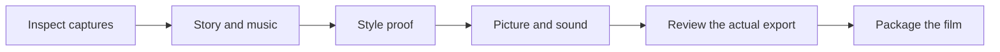

# Cinematic Memory Reel

A reusable AI editing skill for turning personal footage and photographs into a coherent short film: considered pacing, intentional photo layouts, consistent colour and sound that belongs to the scene.

This repository contains a generalized design process, an installable skill, a pasteable prompt and two small local verification tools. It includes **no personal media, private project history, music recordings or proprietary editing assets**.

## Use it in an AI chat

Copy [PROMPT.md](PROMPT.md) into a chat and supply your own footage or description. Nothing needs installing. A chat without editing tools can plan the film; it cannot render or verify files it cannot access.

## Install the skill

Download this repository and copy the entire [skills/cinematic-memory-reel](skills/cinematic-memory-reel) folder into your assistant's supported skill directory. Keep its supporting folders together.

For Codex, the usual user skill directory is `~/.codex/skills/`. Invoke it with:

```text
Use $cinematic-memory-reel to edit my clips and photographs into a
short vertical memory film, with restrained motion and nature sound
that follows its own clip under the music.
```

Other assistants can read `SKILL.md` or use the standalone prompt. Compatibility with every assistant's installer is not claimed. Installing the skill does not install an editor, add connectors or grant permission to publish media.

## The process



Choose what the opening promises, what the middle reveals and where the ending leaves the viewer. A calm film and a punchy reel can use the same footage differently.

Read the [design process](skills/cinematic-memory-reel/references/design-process.md), [sound and finishing notes](skills/cinematic-memory-reel/references/sound-and-finishing.md), and [fictional edit-map example](skills/cinematic-memory-reel/references/edit-map.example.json).

## Optional local tools

Python 3.9+ is required. Install FFmpeg/ffprobe separately using the method appropriate for your system. The helpers need no Python packages, API keys, model calls or cloud uploads.

```bash
python skills/cinematic-memory-reel/scripts/inventory_media.py ./my-footage --output ./inventory.json
python skills/cinematic-memory-reel/scripts/verify_export.py ./my-reel.mp4 --width 1080 --height 1920 --fps 30 --require-audio --full-decode --report ./export-check.json
```

The inventory uses content hashes for stable IDs and relative paths. Without ffprobe, media properties remain unknown. The export checker tests technical properties; it cannot judge storytelling, motion quality or voice-free audio. Source media is not modified. Write the inventory report outside the input directory. Existing reports require explicit `--overwrite`. Relative filenames and content hashes can still identify private material; generated reports are not automatically safe to publish.

Run the synthetic tests with:

```bash
python -m unittest discover -s tests -v
```

Tests generate temporary pattern footage and tones. They do not use personal media. Media-dependent tests skip when FFmpeg/ffprobe are unavailable.

## Scope and license

The skill adapts to the brief. It does not require a specific song, model provider, editor, look, duration or collage formula. Use native editing tools when available; no private app bridge is bundled.

Code and instructions are released under the [MIT License](LICENSE). That license does not cover anyone's footage, likeness, music or third-party assets.
